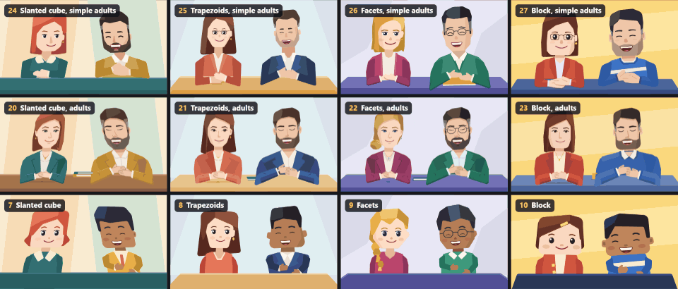
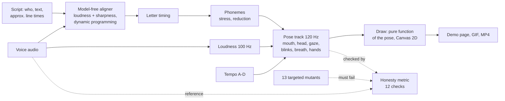
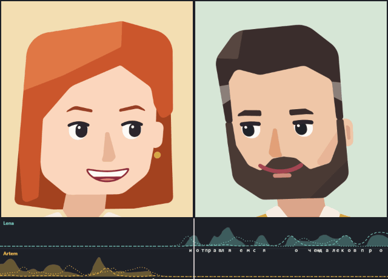
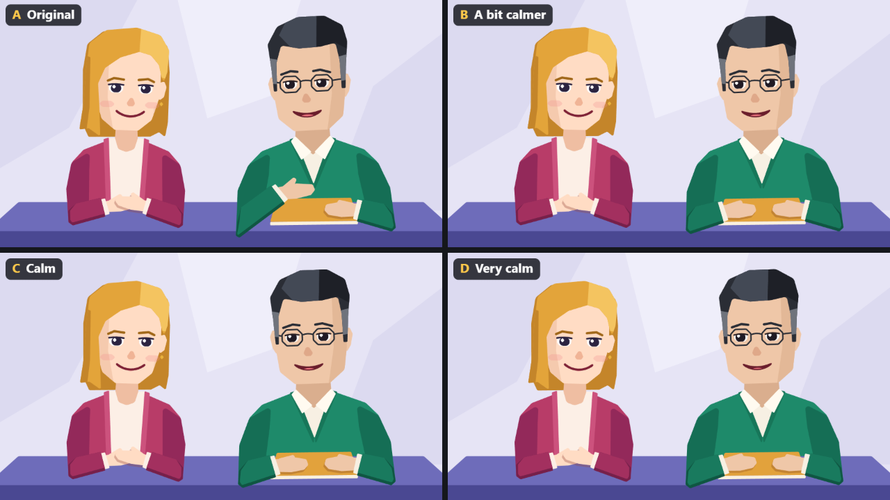
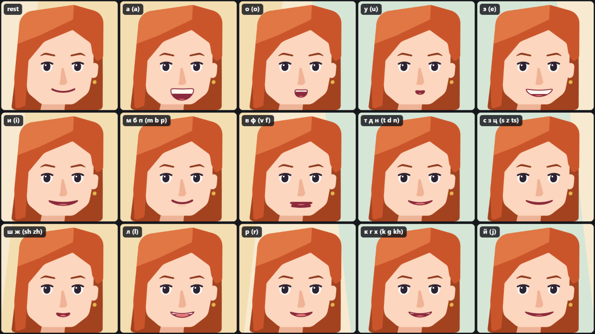

# Procedural Lip-Sync Avatars in Canvas 2D

**Two lesson hosts drawn entirely in Canvas 2D and lip-synced to real dialogue audio, with no sprites and no ML at runtime. A baker turns timed letters plus loudness into a 120 Hz pose track for mouth, head, gaze, blinks, breathing and hands; every frame is a pure function of that pose, so playback, seeking and video export always agree; a model-free aligner times the letters against the voice; and a mouth-honesty metric, judged against the clean voice and itself mutation-tested, keeps the lip-sync honest. 12 drawing styles in 3 groups, 4 animation tempos, one shared parametric mouth.**



I built this for an AI-first EdTech platform for school lessons (live in production), where two hosts, Lena and Artem, talk the platform's conversation lessons through. A teammate built the lesson shell, the realtime voice loop and CI/CD; the hosts are my part. The styles were compared on an internal test page inside the platform, first 19 versions, then 12 in three groups, so the team could pick one design for all lessons. This repository is that subsystem as a standalone project: the baker, the drawing kit with all 12 styles, the aligner, the metric with its mutation tests, a deterministic exporter, and a GitHub Pages demo on a 42 s excerpt of a real lesson dialogue.

| | |
|---|---|
| **Runtime** | Plain browser JavaScript and Canvas 2D: no framework, no build step, no runtime dependencies |
| **Pose track** | 26 parameters per host at 120 points per second, baked once; `poza(t)` interpolates |
| **Styles** | 12 in 3 groups (simple adults, detailed adults, geometric originals) plus the first edition; 21 to 104 drawn shapes per host (fill and stroke calls) |
| **Lip-sync check** | 12-check honesty metric against the clean voice: 12/12 on tempos A, B, C and 11/12 on D on the demo clip |
| **Mutation tests** | 13 of 13 targeted broken animations caught, 1 documented survivor |
| **Tests** | 53 `node:test` tests, under 15 s, no browser needed |
| **Export** | Frame-exact MP4/GIF through headless Chrome and ffmpeg; frames pixel-identical across page loads |
| **Content** | The lesson content is in Russian; code, comments and docs are in English |

Measurements above were taken on 2026-11-20 in this repository unless a row says otherwise; how each one is produced is listed under [Numbers and where they come from](#numbers-and-where-they-come-from).

---

## How it works



1. **Script and voice in.** A line needs a speaker, its text and approximate bounds. TTS word timestamps help but are optional.
2. **The aligner** (`tools/vyravnivanie.mjs`) describes the voice by loudness and sharpness every 10 ms and places every letter of a line at once by dynamic programming over five sound classes (vowel, fricative, sonorant, voiceless and voiced stop).
3. **The baker** (`src/rech.js`) turns letters into Russian phonemes (stress dictionary, vowel reduction, `-ого` read as `-ово`), maps them to seven mouth parameters, smooths them without lag, forces real lip closures on m, b, p, and layers nods on stressed syllables, partner-aware gaze, listener nods, blinks, breathing and gestures on top. All randomness is seeded.
4. **A style** (`src/stili/*.js`) draws a pose through the contract in `src/stili/_kit.js`. Every style draws its mouth with the same parametric bezier contour (`Kit.rot`), so one metric covers all of them.

The full pipeline with the data formats is in [docs/POSE_TRACK.md](docs/POSE_TRACK.md).



## The demo

`index.html` is a static page (GitHub Pages ready): pick a style and a tempo, play and seek. Views: the stage, all 12 styles at once, one style in the 4 tempos, a mouth close-up and the sheet of 15 mouth shapes. Under the stage a strip plots the baked track around the current time, and a readout shows the shape count, the live frame cost and the current sound of each host. `v1.html` plays the same dialogue with the first edition (`src/personazh.js`, four pairs).

| | |
|---|---|
|  |  |
|  |  |

## Engineering decisions

- **Bake first, draw second.** The pose is computed once for the whole clip and the drawing never reads a clock. A frame is `draw(style, pose(t))`, so pause, seek, 0.5x playback and offline export show identical pictures, and the whole animation can be tested in Node with a recording mock canvas.
- **A parametric mouth instead of visemes.** The mouth is one closed bezier contour driven by open, wide, round, teeth, tongue, press, bite and smile. Shapes morph continuously, so there are no pops between sounds, and a new style inherits a working mouth by calling `Kit.rot` with its own colours and scale.
- **No model in the loop.** Letter timing comes from a few hundred lines of dynamic programming over loudness and sharpness, not from an ASR model or a network call. On the demo clip the aligner alone (text plus line bounds, no TTS timestamps) produces a track that passes all 12 honesty checks on all four tempos; the same letters spread naively fail 4 of 12.
- **A metric that cannot agree with itself.** An earlier check compared the mouth with the very letters it was computed from and scored 100% on broken versions. The honesty metric uses the clean voice as the reference: voice activity, silences and the acoustic closure of "p" in the 800-4000 Hz band. It is a dependency-free port of the original Python/scipy check and reproduces its values exactly on the demo clip.
- **Test the test.** Fourteen mutants break the baker, the baked tracks or its input on purpose (all vowels as "a", no lip closure, a jaw flap, a listener who chews, a 150 ms sync lag, no aligner...). Thirteen are caught by the check aimed at them. The fourteenth survives because it acts in pauses shorter than any check looks at; it stays in the suite as a documented blind spot instead of being hidden. Details in [docs/MOUTH_METRIC.md](docs/MOUTH_METRIC.md).
- **Check the drawing too.** A clean track is useless if hair, a beard or a raised hand covers the mouth. `rot-vidno.mjs` renders 252 extreme poses per host with and without the mouth and measures how much of it stays visible, how wide "a" is on a phone, and that no teeth show through a closed "m".
- **Tempo as data.** Feedback on the first version was "great animation, but too much of it". Instead of hand-tuning one character, the motion became four parameter sets over the same pipeline, measured in events per minute (nods 28.7, 22.7, 17, 10 and blinks 20.1, 15.5, 12.2, 10.7 for tempos A to D on the lesson they were designed on).
- **Design by iteration, measured.** The first edition used 36 shapes per character. Feedback ("too detailed") led to versions with 10-18 shapes; feedback on those ("uncanny valley") was traced to the faces, not the shape count: the pupil filled 23% of the eye white and the mouth corners rose 2.6 px while talking, turning the mouth into a slit with a grin of teeth. The fix brought 17-21 shapes and friendlier eyes, and later rounds produced the geometric families and their adult versions shown here.

## Numbers and where they come from

| number | source |
|---|---|
| 120 points per second, 26 tracks per host | `HZ=120` and the track list in `src/rech.js`; asserted in `test/determinism.test.mjs` |
| 12 styles in 3 groups, after an earlier page of 19 versions | the comparison page history (project notes, November 2026); the 12 are asserted in `test/styles.test.mjs` |
| 36 shapes, then 10-18, then 17-21 per character | project notes for the first three editions (those editions are not part of this repository, except the first edition as `v1.html`) |
| 21-104 drawn shapes per host (fill and stroke calls) for the 12 shipped styles | `Stili.schet` on a mock canvas, measured 2026-11-20 |
| mouth visible in at least 98.3% of the mouth area in the worst pose, "a" 20.1-28.3 px wide on a phone, 0.9-3.6 ms per frame for light versions and about 7 ms for heavy ones | project notes for the fourth-edition set (8 versions, 2 of them heavier than anything shipped here) |
| 97.9-100% visible, "a" 19.1-28.3 px, 0 teeth pixels on "m", for the 12 shipped styles | `npm run measure:mouth`, measured 2026-11-20 |
| 1.5-5.6 ms per frame at 960 px for the 12 shipped styles | `npm run measure:speed`, headless Chrome on a desktop PC, measured 2026-11-20 |
| tempo table: nods 28.7 / 22.7 / 17 / 10, blinks 20.1 / 15.5 / 12.2 / 10.7 per minute | project notes, measured on the lesson the tempos were designed on |
| the same on the demo clip: nods 29.3 / 22.1 / 17.9 / 10.7, blinks 19.3 / 15.0 / 10.7 / 10.0 | `npm run motion`, measured 2026-11-20 (42 s clip, so each event moves a figure by about 0.7) |
| honesty 12/12 (A, B, C) and 11/12 (D); 13/13 mutants caught | `npm run honesty`, `npm run mutants`, `npm test`, measured 2026-11-20 |
| 42 s of 1080p 12-style video exported in 57 s; sampled frames pixel-identical across two page loads (8 of 8 and 6 of 6) | `node tools/media.mjs`, `node tools/video.mjs --verify`, measured 2026-11-20 |

## Run it

Requirements: Node 22 or newer. The export and measurement tools also need ffmpeg on `PATH` and an installed Chrome (or `CHROME_PATH`).

```bash
npm install            # only playwright-core, used by the export and measurement tools
npm test               # 53 tests: metric, mutants, determinism, style contract, aligner (no browser)
npm start              # demo at http://127.0.0.1:41700
```

Reports and measurements:

```bash
npm run honesty        # the 12 checks for every tempo
npm run mutants        # which checks each mutant fails (add a tempo: npm run mutants -- tiho)
npm run motion         # nods, blinks, gaze shifts, gestures per minute
npm run measure:mouth  # mouth visibility in the drawing (headless Chrome)
npm run measure:speed  # frame cost per style (headless Chrome)
```

Build a track and export video:

```bash
node tools/build-track.mjs data/demo.script.json             # script + voice -> data/demo.json
node tools/build-track.mjs data/demo.script.json --no-hints  # ignore TTS word timestamps
node tools/video.mjs --mode grid --out release-assets/grid.mp4
node tools/video.mjs --mode closeup --strip --gif --from 12 --to 17 --width 640 --out closeup.gif
node tools/video.mjs --verify 12                             # determinism check on real pixels
node tools/media.mjs                                         # regenerate every image in docs/ and the release videos
```

To publish the demo, enable GitHub Pages on the repository root. The `.nojekyll` file matters: Jekyll would otherwise drop `src/stili/_kit.js` because its name starts with an underscore.

## Repository layout

```
index.html            demo page (GitHub Pages): style, tempo, views, pose-track strip
v1.html               the first edition (personazh.js), four pairs
render.html           headless frame renderer used by the exporter
src/rech.js           the baker: letters + loudness -> 120 Hz pose track, phoneme table, tempos
src/personazh.js      first-edition character, a pure function of the pose
src/stili/_kit.js     shared kit and style contract: Kit.rot mouth, eyes, brows, arms, head turn
src/stili/*.js        12 styles: kosoy, trapecii, grani, blok and their *2 (detailed adults) and *3 (simple adults)
src/stage.js          scene, grid, tempo grid, close-up, mouth sheet, pose-track strip
src/demo.js, v1.js, render.js   page logic
tools/vyravnivanie.mjs   model-free aligner
tools/build-track.mjs    script + voice -> baker input
tools/udar.json          stress dictionary
tools/proverka/          honesty metric, mutants, motion stats, mouth visibility, frame cost
tools/video.mjs          deterministic MP4/GIF/PNG export; media.mjs regenerates all visuals
tools/server.mjs         static server with HTTP Range (needed for audio seeking)
test/                    node:test suites
data/                    demo script, track, voice (MP3 for playback, 16 kHz WAV as the metric's reference)
docs/                    pipeline, metric, glossary of transliterated names, media
```

Identifiers are transliterated Russian (`rech` = speech, `stili` = styles, `rot` = mouth); [docs/GLOSSARY.md](docs/GLOSSARY.md) translates them.

## Status

- Built in November 2026. The 12-style comparison ran as an internal test page inside the production platform so the team could choose one host design; this repository does not claim the hosts were rolled out to student lessons.
- The demo track is one 42 s dialogue excerpt. All measured numbers here come from that clip; longer material may move them.
- Tempo D misses the vowel bar on this clip (96.6% against 97%), and the metric does not see pauses shorter than 0.16 s. Both are asserted in the tests and listed in [docs/MOUTH_METRIC.md](docs/MOUTH_METRIC.md).
- The stress dictionary covers the words of the original lessons and the demo; unknown words fall back to a safe half-round "o".
- Frame cost was measured on a desktop only; phone timings were not measured.
- Roadmap: a short-pause check for the metric, a stress dictionary from an open lexicon, and an English phoneme table.

## Credits and licenses

- **Code:** MIT, see [LICENSE](LICENSE).
- **Voice:** ElevenLabs. The demo is a 42 s excerpt of a lesson dialogue (Russian). Its text was written for the lesson from textbook facts and passed a copyright overlap check against the school-textbook sources it draws on: no run of 8 or more consecutive words is shared; the longest shared run is 7 words (a lesson question).
- **Characters and all images in `docs/`:** drawn by the code in this repository and rendered with `tools/media.mjs`; no third-party art, no AI-generated images, system fonts only.
- **Tools:** [playwright-core](https://github.com/microsoft/playwright) (Apache-2.0) drives Chrome for export and measurements; [ffmpeg](https://ffmpeg.org/) encodes video (external tool, not bundled).

Code was written AI-first with Claude Code; architecture, decisions and acceptance are mine.

## License

MIT
