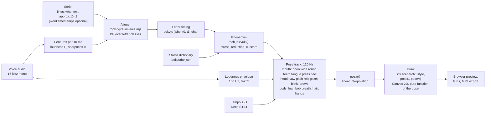

# The pose track

Everything the hosts do on screen comes from one baked data structure: a set of `Float32Array` tracks sampled at **120 points per second** (`HZ=120` in `src/rech.js`). The drawing code never looks at audio, letters or the clock. It receives a pose for time `t` and draws it. That split is what makes the animation seekable, testable and exportable frame by frame.



## 1. Input: text and audio

`tools/build-track.mjs` turns a script plus its voice into the baker's input (`data/demo.json`):

```js
{ scene, total,                       // id and length in seconds
  bukvy:   [[who, t0, t1, char], ...], // every character of every line, spaces and punctuation included
  repliki: [{id, who, t0, t1, show, vopros, vosk}, ...], // lines: speaker, bounds, text, question?, exclamation?
  energy:  [0-255, ...],              // loudness at 100 Hz, p98 of the clip = 200
  udar:    {word: stressedLetterIndex} }
```

The script (`data/demo.script.json`) gives each line its speaker, text and approximate bounds. Word timestamps from a TTS "with timestamps" response are optional and only act as a soft hint.

## 2. Letter timing without a model

`tools/vyravnivanie.mjs` aligns the letters of each line to the voice itself. No ASR model, no network:

- The voice is reduced to two features per 10 ms frame: loudness `E` (dB relative to the clip's 95th percentile) and sharpness `H` (energy of the first difference over energy, a cheap proxy for high-frequency content).
- Each letter belongs to a class: vowel (loud and dull), fricative (sharp), sonorant (medium and dull), voiceless stop (quiet) or voiced stop. Word gaps become optional silence states, punctuation allows longer ones.
- Dynamic programming places every letter of the whole line at once, maximising how well the frames match each class, with a Gaussian duration prior per class and, when hints exist, a penalty for drifting more than 100 ms from the hint.
- Neighbouring lines of the other speaker bound the search, so a line never borrows the partner's audio.

Measured on the demo clip (2026-11-20): with word hints the aligner moves letters by 67 ms on average from their word-based first guess; with line bounds only, by 217 ms from an even spread over the line. The line-bounds-only track passes all 12 honesty checks on all four tempos and the hinted one on tempos A, B and C (see `docs/MOUTH_METRIC.md`); the same letters spread evenly without the aligner fail 4 of 12 checks.

## 3. Letters to phonemes

`zvuki()` in `src/rech.js` works word by word, because a Russian vowel's sound depends on stress and neighbours:

- A stress dictionary (`tools/udar.json`) marks the stressed vowel. Unstressed `о`/`а` become the reduced `ar`, unstressed `е`/`я` become `ir`. Without a dictionary entry a multi-vowel word falls back to a half-round `o2`, so an unknown word never gets a full "o".
- `-ого`/`-его` endings read `г` as `в` (except a small exception list such as "много").
- Iotated vowels after a vowel or soft sign split into `й` plus the vowel.
- An all-caps abbreviation without vowels is spelled by letter names.
- Identical consonants closer than 30 ms merge into one.

## 4. Phonemes to the mouth

Table `F` maps 20 sound classes to seven mouth parameters:

| param | meaning |
|---|---|
| `open` | jaw opening (1 = "a") |
| `wide` | lip spread (-1 rounded, 1 spread) |
| `round` | lip rounding |
| `teeth` | how much of the upper teeth shows |
| `tongue` | tongue tip raised (t, d, n, l, r) |
| `press` | lips pressed (m, b, p) |
| `bite` | lower lip under the upper teeth (v, f) |

The baker then:

1. Re-times every sound against the voice: the coarse letter grid often gives the pause before a phrase to its first letter, so starts and ends are pulled to where the voice actually is.
2. Normalises loudness per voice, so one host is not more "mouthy" than the other.
3. Scales vowel opening by local loudness and lets lips prepare for the next vowel during a consonant (anticipatory rounding).
4. Writes step targets with a 30 ms lead, smooths each parameter with a zero-lag forward-backward filter, and enforces lip closure on m, b, p and contact on v, f with a smoothstep mask centred on the loudness minimum next to the letter, so smoothing cannot eat the closure.
5. In the soft tempos, force-closes the mouth after 0.12 s of silence in the host's own voice.
6. Applies a one-sided rate limiter that only lowers values (closures stay at exactly zero) and a final light smoothing.

## 5. The rest of the body

Everything else is layered physics on events extracted from the same speech:

- **Beats**: loudness peaks on vowels, at most one per 0.4 s (tempo dependent), drive nods (a damped spring on `pitch`), brow raises and hand beats.
- **Gaze and head turn**: the speaker mostly looks at the partner and sometimes at the viewer; the listener looks at the speaker; lines with an `intro` id are addressed to the viewer. Eyes lead, the head follows through springs on `yaw`, `roll` and `lean`, hair follows the head last.
- **Listener behaviour**: a nod at the end of the partner's long phrase; brows rise at the partner's question.
- **Blinks**: random intervals per tempo, sometimes doubled.
- **Breathing**: a slow sine that speeds up while speaking, plus an inhale impulse 0.28 s before each phrase.
- **Hands**: gestures only on long phrases, chosen from four poses, the dominant hand picked per line; between phrases the palms rest on the table.

All randomness comes from a seeded generator (`hash(scene + host)`), so the same input always yields the same track.

## 6. Tempos

`Rech.STILI` holds four parameter sets over the same pipeline: A "original", B "a bit calmer", C "calm", D "very calm". They change only strength, frequency and softness. Per host per minute:

| | A | B | C | D | source |
|---|---|---|---|---|---|
| nods | 28.7 | 22.7 | 17 | 10 | lesson podcast, measured when the tempos were designed |
| blinks | 20.1 | 15.5 | 12.2 | 10.7 | same |
| nods | 29.3 | 22.1 | 17.9 | 10.7 | demo clip, `npm run motion`, measured 2026-11-20 |
| blinks | 19.3 | 15.0 | 10.7 | 10.0 | same |

The demo clip is 42 s, so each event changes the per-minute figure by about 0.7.

## 7. Output and drawing

`Rech.bake(data, 'L', {storona: 1, stil: 'chut'})` returns `{treki, poza(t), zv, udary, HZ}`. `poza(t)` linearly interpolates every track between the two nearest samples. A style draws a pose through the contract in `src/stili/_kit.js`:

```js
Stili.dobavit({id, nomer, imya, gruppa,
  fon(c, W, H) {},          // background, 1920x1080 scene units
  stol(c, W, H) {},         // optional table between bodies and arms
  L: {x, y, s, ramka, telo(c, p) {}, ruki(c, p) {}},   // Lena, left
  A: {...}});                                          // Artem, right
```

Every style draws its mouth through `Kit.rot`, the same parametric bezier contour with the same numbers as the first edition (`src/personazh.js`). That is why one mouth metric and one visibility check cover all twelve styles.

Identifiers are transliterated Russian; `docs/GLOSSARY.md` translates them.
